<!--
  ╔══════════════════════════════════════════════════════════════════╗
  ║  Sai Mendoza — GitHub Profile README                               ║
  ║                                                                    ║
  ║  IMPORTANT — two files, both go in the repo root:                  ║
  ║    • README.md   (this file)                                       ║
  ║    • banner.svg  (the animated header graphic)                     ║
  ║                                                                    ║
  ║  Why two files: GitHub's README renderer sanitizes raw inline      ║
  ║  <svg> markup and drops <style>/@keyframes, so an animated SVG     ║
  ║  pasted directly into the Markdown body will not animate. When     ║
  ║  an SVG is instead its own file and referenced with an        ║
  ║  tag, GitHub serves it as a raw, unsanitized image file — so the   ║
  ║  CSS animations inside it run normally. This is how most animated  ║
  ║  GitHub profile banners are built, and it still uses no            ║
  ║  third-party image host: banner.svg lives in your own repo.        ║
  ║                                                                    ║
  ║  How to edit this file:                                            ║
  ║   1. Banner: edit banner.svg directly — change the <text>          ║
  ║      content or the <style>/@keyframes rules to adjust it.         ║
  ║   2. Featured Links: update the badge URLs / hrefs below to        ║
  ║      point to new projects.                                        ║
  ║   3. Tech Stack: edit the `i=` query param on the skillicons.dev   ║
  ║      URL to add/remove tech badges (comma-separated, no spaces).   ║
  ║   4. Colors: the banner uses GitHub's dark theme background        ║
  ║      (#0d1117) to blend seamlessly in dark mode.                   ║
  ╚══════════════════════════════════════════════════════════════════╝
-->

<!-- ============================================================ -->
<!-- ANIMATED HEADER BANNER                                        -->
<!-- Lives in banner.svg (own repo file, not a third-party host).  -->
<!-- Referenced via  so GitHub serves it raw and its CSS      -->
<!-- @keyframes animations actually run.                           -->
<!-- ============================================================ -->

 

<!-- ============================================================ -->
<!-- FEATURED LINKS                                                -->
<!-- ============================================================ -->
<!-- Edit the href below to update your portfolio link/badge -->

 

## 🚀 Featured Projects

<!-- Add a new row to this table to feature another project -->
| Project | Description | Link |
|---|---|---|
| **CITEC UDays Attendance System** | QR-code based attendance management system built with Next.js | [View Repo](https://github.com/Daniel2525-ui/CITEC-UDays-Attendance-System) |
| **PopSeatReserve** | Web app for browsing and reserving seats in real time | [View Repo](https://github.com/shinzicantconnect/PopSeatReserve) |
| **Drip** | A web project exploring a modern, clean UI/UX build | [View Repo](https://github.com/shinzzzzyyyy/Drip) |

 

<!-- ============================================================ -->
<!-- TECH STACK                                                    -->
<!-- ============================================================ -->

### 🛠️ Tech Stack

<!-- Add/remove tech by editing the comma-separated `i=` list below -->

 

<!-- ============================================================ -->
<!-- FOOTER                                                        -->
<!-- ============================================================ -->

Built with ❤️ by Sai Mendoza — the header banner is an animated SVG hosted in this very repo, no external image hosting required.

